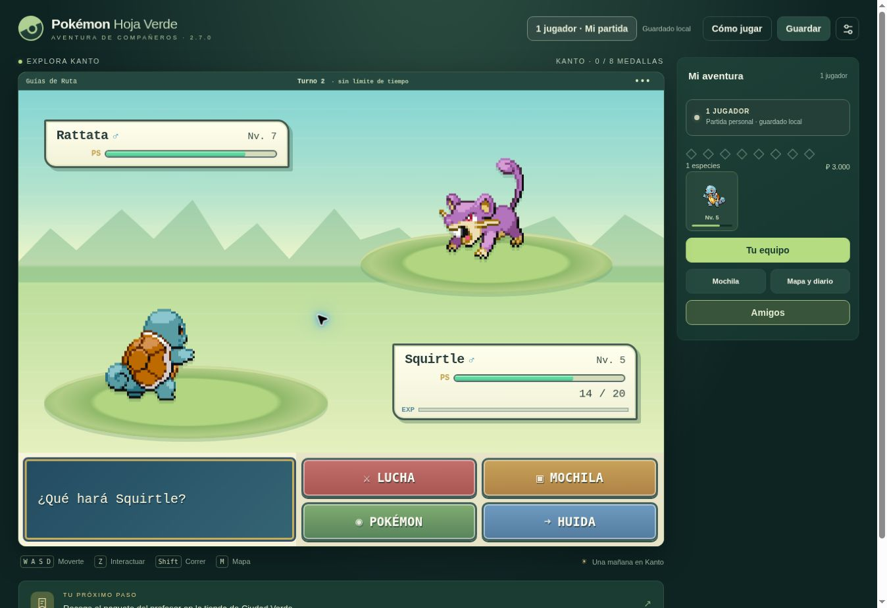

# Compañeros 2.7.0 — combate clásico e interiores

Esta actualización prioriza la aventura personal, conserva la interfaz portátil y mantiene compatibles los mundos para amigos.

- El Rocket del Puente Pepita ya no detecta a un jugador que no ha vencido a los cinco entrenadores. Un desafío bloqueado muestra su requisito y libera el movimiento; los bloqueos antiguos se recuperan al sincronizar.
- Pantalla de combate con cuatro comandos, PS numéricos, sexo/estado y experiencia. Los ataques, mochila y cambios se abren desde ese menú. La huida usa velocidad e intentos; fallar consume el turno. Los entrenadores no permiten huir.
- 159 pares de sprites BW de cuerpo completo distribuidos por PokéAPI; se mantiene la escala y el filtrado pixelado. No se emplea una ROM. Procedencia en BATTLE-SPRITES-CREDITS.md.
- Casas de 13×11 casillas amuebladas, dormitorio de 12×10 con escaleras funcionales, Centros de 15×12, tiendas de 11×11 y laboratorios de 17×12. Nuevos suelos, alfombras y muebles con colisiones. Los espacios de historia más grandes reciben mobiliario sin alterar sus conexiones.
- 19 escenas musicales, 16 pistas y 35 efectos nuevos. Las familias de ataque tienen sonidos propios; se elimina el efecto genérico de energía y el golpe duplicado. Créditos, fuentes y licencias en assets/audio/CREDITS.md. La música se precarga para uso offline tras la instalación inicial.
- Mundo revisión 5: las posiciones antiguas que queden fuera del nuevo interior o sobre muebles se trasladan a una casilla segura. Se conservan identidad, equipo, IV/EV, movimientos, objetos, decisiones y progreso.

## Validación

- Pruebas del motor local compilado sin fetch, incluyendo reanudación de combates y guardados.
- Recorrido automatizado individual de 29 encuentros obligatorios, ocho medallas, Alto Mando y campeón; guardado y recarga después de cada encuentro. Usa equipos de nivel 100 como fixture de integración: no mide la dificultad de una partida normal.
- Comprobación de accesibilidad de 112 mapas, puertas, escaleras, NPC, objetos y entradas; los jardines opcionales mantienen el requisito de Corte.
- Regresiones de bloqueo del puente, huida fallida/exitosa, recuperación tras derrota, movimiento, cambios de mapa y migración de posiciones.
- Comandos de combate, experiencia y 318 imágenes de frente/espalda comprobados; renderizado real de Canvas de seis interiores revisado. Interfaz comprobada en navegador de escritorio y en 390×844, 360×640 y 844×390, incluyendo un turno, los cuatro comandos y la recarga del combate.
- Pruebas de convivencia con multijugador: consentimiento, amigos, regalos, intercambio, progreso individual y combates independientes.

## Alcance

La campaña es una adaptación propia de Kanto, con reglas de combate de tercera generación. No es una copia íntegra de los mapas, diálogos, scripts, banda sonora y eventos de la ROM oficial. Las pruebas de progresión no constituyen una garantía de ausencia de errores ni una prueba completa de equilibrio. Se mantienen 159 especies disponibles; no se agregan generaciones completas en esta edición.

