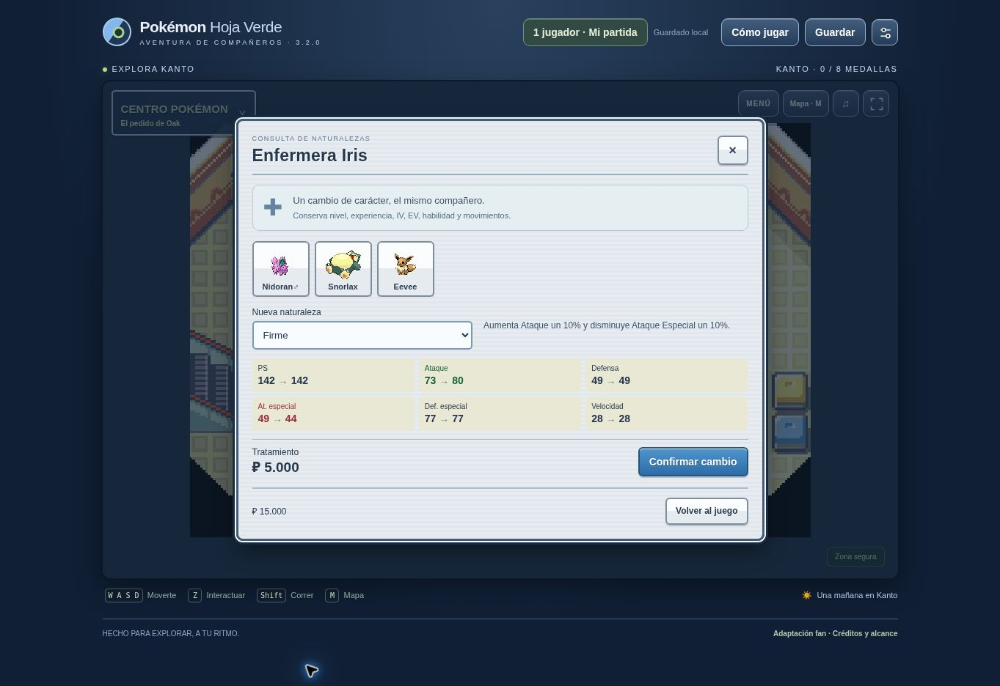

# 3.2.0 · Servicios de Kanto y presentación de combate

## Cambios para jugar

- Nidoran♂ tiene encuentros propios en las rutas 1, 2 y 22 (junto a Nidoran♀); se conserva la identidad masculina en captura, guardado y Pokédex.
- Enfermera **Iris** junto a Joy en los 19 Centros Pokémon originales. Permite elegir las 25 naturalezas por **₽5.000**, comparando las seis estadísticas antes de confirmar. Conserva identidad, nivel, experiencia, IV, EV, habilidad, movimientos, PS y estado. Cambiar a la misma naturaleza no cobra.
- Grandes Almacenes de **Azulona** con mostradores distintos: objetos y MT en el segundo piso, tutor de Contraataque en el tercero, piedras en el cuarto, vitaminas y objetos X en el quinto y bebidas en la azotea. Las piedras evolucionan Pokémon compatibles, las MT permiten elegir el movimiento que se olvidará y las vitaminas respetan los límites de EV.
- La niña de la azotea entrega sus tres MT a cambio de bebidas diferentes, una vez por regalo.
- Casino de Azulona: Monedero del restaurante, fichas persistentes, compra de fichas, regalos limitados de los clientes y mostradores de Pokémon, MT y objetos. Las tragaperras son una adaptación compacta propia: una línea de tres fichas, probabilidades fijadas en el servidor y reglas visibles. No replican todas las modalidades del minijuego de GBA.
- Regalo de una Poción del empleado original de la Ruta 1, una sola vez. Bono Bici del presidente del Club Pokémon de Carmín y canje en Ciudad Celeste. Bicicleta utilizable desde la mochila, el botón del mapa o B, con sprite propio y velocidad mayor; se baja al entrar en interiores y es obligatoria en el Camino de Bicis.
- Entradas de entrenadores con retratos originales, aparición sucesiva de los Pokémon, contadores de equipo y opción de saltar la presentación. Barras de PS animadas y lanzamiento/sacudidas de las Balls dentro de la secuencia de turnos.
- Aviso periódico suave cuando **el Pokémon activo del jugador** tiene PS rojos y sigue consciente. Se detiene al curarse, debilitarse, terminar el combate o silenciar el audio. Las pistas HG y los efectos existentes se mantienen.
- Captura corregida con los redondeos enteros, raíces enteras y cuatro comprobaciones de Rojo Fuego. La mochila muestra una estimación con los PS y estado actuales. Un Snorlax de 139 PS máximos, a 1 PS y dormido, tiene aproximadamente 33,7% con Super Ball y 41,0% con Ultra Ball; no es una captura garantizada.
- IA de entrenadores que compara daño físico/especial, precisión, inmunidades, estados, curación, potenciación y relevos. Evita cambios consecutivos innecesarios. No consulta la acción que acaba de elegir el jugador. Es una heurística propia, no una importación completa de la IA de Radical Red.
- Objetos equipables del casino, Bola Humo para escapar y Flauta Amarilla reutilizable que cura confusión a cambio de un turno.

## Comprobaciones

- `npm run build` y `npm test` del juego: 66 comprobaciones/suites PASS, incluidas 12 nuevas de servicios, captura, encuentros, IA, objetos y presentación.
- Se verifican las 25 naturalezas, los 19 Centros y el acceso/interacción a los 74 puntos de servicio desde las entradas originales.
- Pruebas del servidor y Worker compilado: peticiones HTTP independientes, persistencia D1, cobros idempotentes, compras, fichas, guardado portable, PvP, regalos, recuperación y clonación.
- Navegador de escritorio: consulta y cobro de Iris, compra de Piedra Agua, compra de fichas y entrada de Brock. Vista de 390 × 844: menú de Iris y activación de bicicleta conservando la consola azul.
- La revisión cubre estos servicios y las regresiones automatizadas de campaña. No equivale a una partida manual completa con cada NPC, ni declara implementados todos los scripts originales o todas las funciones de Radical Red.

## Referencias

- [pret/pokefirered](https://github.com/pret/pokefirered), commit `ce6406d8c2eaf46d543c8a2606de0c3cb1951982`: captura (`src/battle_script_commands.c`), aviso de PS (`src/battle_gfx_sfx_util.c`), guiones de tiendas/casino y arte de entrenadores/bicicleta.
- [Complete Fire Red Upgrade](https://github.com/Skeli789/Complete-Fire-Red-Upgrade), commit `b637a27898b14e25dd24d0f69a3e302f0069deb8`: referencia del enfoque de puntuación de ataques y relevos.
- Archivo Radical Red 4.1 aportado: inspección de textos del cambio de naturaleza. Su diálogo indica gratuidad; el coste de ₽5.000 es una decisión de equilibrio de esta adaptación solicitada por el usuario. No se ejecutó ni se distribuye la ROM.

