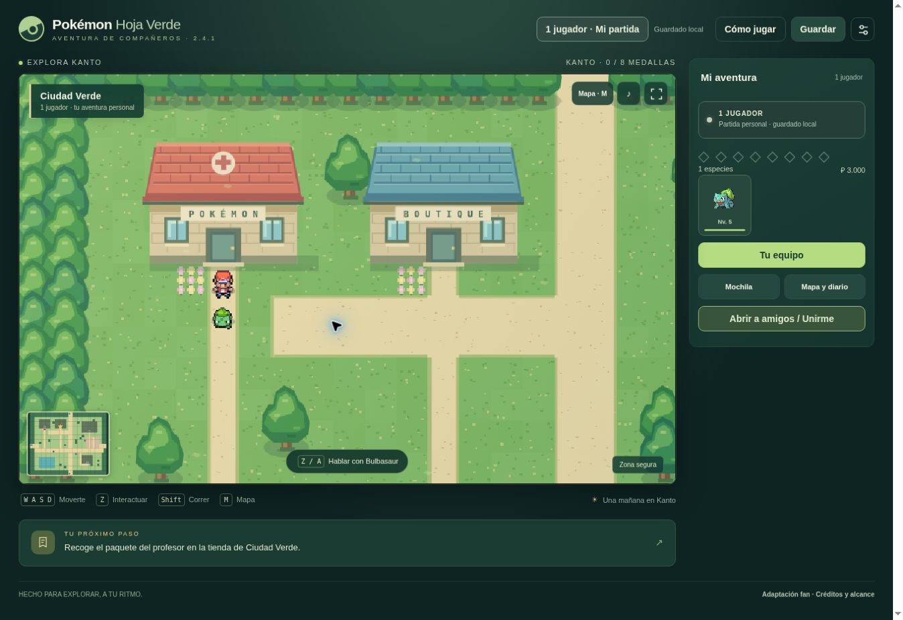

# Correcciones 2.4.1

## Centros Pokémon y movimiento

El punto de recuperación copiaba toda la posición, incluido `seq`, el contador que confirma los pasos. Tras una derrota podía rebobinarlo y dejar una solicitud de movimiento esperando para siempre. Eso impedía caminar y provocaba el aviso de reconexión al intentar abrir una partida local a amigos.

Ahora el punto de descanso sólo contiene mapa, coordenadas y dirección. Recuperarse conserva la secuencia actual y descarta una alerta de entrenador anterior. El cliente puede reconciliar una confirmación antigua y continuar desde la posición aceptada. No hay que crear una partida nueva ni borrar el guardado. Las pulsaciones breves de teclado o cruceta empiezan un paso inmediatamente, sin depender de coincidir con el siguiente fotograma.

## Presentación de los combates

Los eventos públicos del simulador tienen índices estables. El cliente muestra cada ataque, su daño o efecto y la siguiente acción en ese orden; no cambia los PS de ambos lados de golpe. Los controles de decisión esperan al final de la secuencia. «Mostrar resultado» permite saltarla. Los avisos de recuperación se muestran después del desenlace.

El resultado individual dice «¡Has ganado el combate!», incluso si otros jugadores están recorriendo el mundo. «¡Victoria en equipo!» requiere más de un entrenador humano en ese combate.

## Variedad inicial

| Zona | Encuentros | Niveles |
| --- | --- | --- |
| Ruta 1 | Pidgey 40%, Rattata 40%, Caterpie 10%, Weedle 10% | 2–4 |
| Ruta 2 | Pidgey 30%, Rattata 30%, Caterpie 17%, Weedle 18%, Abra 5% | 3–7; Abra 5–7 |
| Ruta 22 | Rattata 25%, Mankey 25%, Spearow 20%, Nidoran♀ 15%, Nidoran♂ 15% | 2–5; Nidoran 3–5 |

Son adaptaciones deliberadas, separadas de las tablas de referencia en `campaign-encounter-overrides.json`. Los vecinos de Ciudad Verde dan pistas. El motor local y el servidor utilizan las mismas tablas. No se ha ampliado todavía el motor más allá de Gen3.

## Comprobaciones

- Pruebas del motor compartido: campaña, historia, partidas portables, guardado y recuperación real después de una derrota.
- Pruebas del cliente entregado: resincronización de pasos antiguos, apertura con la misma identidad, orden de eventos, PS diferidos y textos de victoria.
- Worker compilado: D1, combate entre solicitudes, PP, anfitrión/invitado, regalo aceptado y salida conservando identidad; recorrido de derrota, salida del Centro y reapertura.
- Navegador: derrota con un equipo de prueba, regreso al Centro, continuación de la partida y salida a Ciudad Verde. Presentación visual de una acción antes de aplicar el daño.

Esto no sustituye una sesión larga de campaña ni una prueba manual conjunta entre dos dispositivos en producción.

